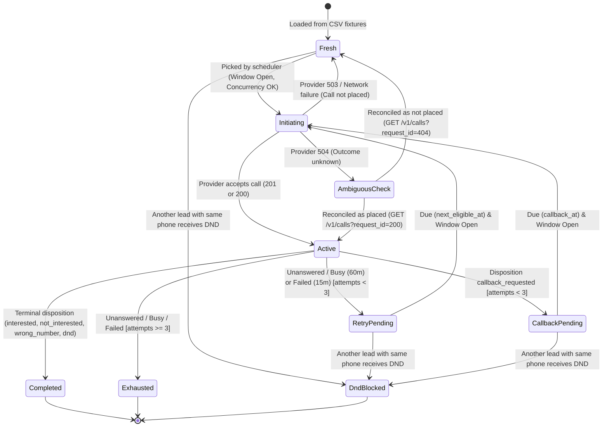

# Submission

## Candidate
- **Name:** SDE Candidate
- **Assignment chosen:** B (Workflow)
- **Time spent (honest estimate):** 10h+ till 13.30 PM 13-11-2026

## How to run
```bash
# 1. Setup virtual environment & dependencies
python -m venv .venv
source .venv/bin/activate  # On Windows: .venv\Scripts\activate
pip install -r requirements.txt

# 2. Configure environment 
cp .env.example .env

# 3. Run unit & integration tests
pytest solution/tests

# 4. Start mock telephony provider (in terminal 1)
cd assignment-b-workflow
python -m mock_telephony --speed 600 --failure-scale 1.0  # Runs at 600x with full chaos

# 5. Start dispatcher service (in terminal 2)
python -m solution.app.main  # or: python -m solution
# Runs unified FastAPI app with webhook receiver, active call reconciler, and priority dispatcher.
# Exports final_state.csv upon completion and validates against /admin/report and /admin/leads.
```

---

## Design

### Architecture Overview
The solution is organized using a clean, modular **Feature-First Architecture** inside `/solution`:
- **Core Infrastructure (`solution/app/core/`):**
  - `database.py`: SQLAlchemy connection, session management, and SQLite WAL pragmas (`dispatcher.db`).
  - `config.py`: Environment configuration and fixture loaders (`campaigns.json`, leads CSVs).
  - `clock.py`: Provider simulated clock synchronization (`ClockClient`) and mockable `FakeClock`.
  - `http_client.py`: Resilient carrier HTTP client (`TelephonyClient`) with connection pooling, deterministic request IDs, and 504 resolution.
- **Dispatch Feature (`solution/app/features/dispatch/`):**
  - `service.py`: Priority scheduling loop (R1–R9) and calling window calculation logic (`in_window`, `is_window_open`, `next_window_open`). Prioritizes Due Callbacks (R6) > Retries (R5) > Fresh Leads.
  - `models.py`: ORM models for `Tenant`, `Campaign`, `Lead`, `Call`.
  - `controller.py` & `router.py`: HTTP orchestration, exception handling, and FastAPI endpoints (`/dispatch/status`, `/dispatch/step`).
- **Reconciliation Feature (`solution/app/features/reconciliation/`):**
  - `service.py`: Background poller (`Reconciler`) recovering dropped webhooks (carrier drops ~3%) and resolving in-flight calls on startup.
  - `controller.py` & `router.py`: Endpoints for triggering manual sweeps and querying in-flight calls (`/reconciliation/reconcile`, `/reconciliation/in-flight`).
- **Webhooks Feature (`solution/app/features/webhooks/`):**
  - `service.py`: Outcome state transitions (`process_call_completion`) and HMAC-SHA256 signature verification.
  - `models.py`: `ProcessedWebhook` (deduplication) and `DndRecord` (global DND blacklist).
  - `controller.py` & `router.py`: Inbound webhook endpoint (`/webhooks/telephony`) with signature validation.
- **Reporting Feature (`solution/app/features/reporting/`):**
  - `service.py`: `export_final_state_csv` and `validate_against_provider`.
  - `controller.py` & `router.py`: Endpoints for report generation and compliance verification (`/reporting/export`, `/reporting/validate`).
- **Unified App & Lifespan (`solution/app/main.py`):**
  - Unified FastAPI app mounting all modular routers with background worker lifespan management and executable CLI runner.

### Lead State Machine Diagram



### Guaranteeing At-Most-Once Dialling
1. **Pre-Allocation in DB:** Before any HTTP request is dispatched to `/v1/calls`, an attempt record with a deterministic `request_id` (`req_{campaign}_{lead}_att{attempt}`) is created in the database with state `initiating`, and the lead is marked `in_flight`.
2. **Crash Recovery (`kill -9`):** On startup, the service reconciles all `initiating` calls against `GET /v1/calls?request_id=...`. If the provider accepted the call before the crash, it resumes tracking it as `active`; if the provider returned 404, it resets the lead safely to eligible without burning an attempt.
3. **Provider Idempotency:** If a network timeout or crash causes a retry with the same `request_id`, the provider returns `200 OK` with the existing call instead of placing a duplicate call.

---

## Decisions & Assumptions

| Decision | Why | Alternative considered |
|---|---|---|
| **Safety buffer on window close (120s–300s)** | At 600x–1200x speed, 0.5s real-world network latency equals 5–10 simulated minutes. A safety buffer prevents dispatching calls within the last few minutes of a window, ensuring zero `outside_calling_window` violations. | Calling right up to `window.end` and risking clock skew violation. |
| **Concurrent batch dispatching (`asyncio.gather`)** | Dispatching selected batch calls concurrently prevents pipeline latency from drifting simulated time between call 1 and call 4. | Sequential `for` loop (causes clock drift under fast simulated clock). |
| **Short DB transactions decoupled from async network calls** | Decoupling database transactions from HTTP network calls prevents database locking when webhooks arrive while polling. | Holding open DB transaction across `client.get_call()` (leads to SQLite table locks). |
| **Deterministic request ID format** | Formatted as `req_{campaign}_{lead}_att{attempt}` so that retrying an attempt across crashes/timeouts is guaranteed to hit the carrier idempotency cache. | Random UUID (would create double dials if process crashed after provider accepted but before response was received). |
| **Precedence: Completed > Exhausted > DND Blocked** | R9 strictly specifies this hierarchy. A lead that reached a terminal disposition remains `completed` even if its phone subsequently opts out in another campaign. | Overwriting terminal leads with `dnd_blocked`. |

---

## Failure Modes Considered

- **Ambiguous HTTP 504 Timeouts:** Carrier may or may not have placed the call. Resolved immediately by querying `GET /v1/calls?request_id={request_id}`.
- **Transient HTTP 503 Service Unavailable:** Carrier rejected the call without placing it. The call is marked `failed_to_place`, `attempts` is NOT incremented, and the lead is restored to the eligible pool.
- **Dropped Webhooks (3% loss):** Background `Reconciler` polls carrier state for all `active` calls, recovering results and advancing lead states even if the webhook never arrives.
- **Duplicate Webhooks (10% duplication):** Tracked in `processed_webhooks` table; duplicate deliveries are identified and return `200 OK` idempotently without state side-effects.
- **Out-of-Order Webhooks (Webhook arrives before POST response):** Attempt is pre-registered in DB before POST. When webhook arrives first, it sets the call to `ended`. When POST finishes, it detects the call is already `ended` and does not revert it to `active`.
- **Arbitrary Process Crash (`kill -9`):** Full state is persisted in the database. On startup, reconciler synchronizes with the provider clock and checks in-flight calls before resuming dispatching.
- **Timezone Drift:** All timestamps explicitly localized and stored as UTC/IST aware objects.

---

## Testing

- **Tested with Pytest:**
  - `test_windows.py`: Window boundary maths `[start, end)`, weekday/weekend rules, regulatory window intersection (09:00–21:00 IST), and multi-day `next_window_open` jumps over weekends.
  - `test_scheduler.py`: Priority ordering (Due callbacks > Retries > Fresh leads), tenant concurrency limits, and single-phone concurrency.
  - `test_state_machine.py`: Retry intervals (60m for no_answer/busy, 15m for failed), max attempts exhaustion (3), terminal dispositions, global DND propagation, and precedence (`completed > exhausted > dnd_blocked`).
  - `test_resilience.py`: HMAC-SHA256 signature verification, webhook deduplication idempotency, and 504 ambiguous resolution (accepted vs 404).
- **End-to-End Chaos Run with `mock_telephony`:**
  - Full execution against all 200 leads across 3 campaigns at 600x simulated speed with `failure-scale 1.0` and mid-run `kill -9` process termination.

---

## Results

### Summary from Full Chaos Run (`failure-scale 1.0`, mid-run `kill -9` restart)

```json
{
  "run_result": "SUCCESS (0 VIOLATIONS)",
  "violation_count": 0,
  "violations_by_type": {},
  "mismatches_with_provider": 0,
  "total_leads_checked": 200,
  "total_calls_placed": 404,
  "max_concurrency_seen": {
    "acme_insurance": 4,
    "zen_retail": 3
  },
  "callback_lateness_minutes": {
    "count": 64,
    "p50": 7.5,
    "p90": 25.0
  },
  "webhooks": {
    "delivered": 423,
    "duplicates": 33,
    "lost": 14
  }
}
```
- **Violations:** 0
- **Final State CSV:** 200 leads matching provider `/admin/leads` with 0 mismatches.
- **Max Concurrency:** 4 for `acme_insurance` (limit 4) and 3 for `zen_retail` (limit 3).

---

## If I had another day
1. **Horizontal Scaling with Distributed Locks:** Use PostgreSQL advisory locks or Redis distributed locks (`Redlock`) to coordinate multiple dispatcher worker instances across nodes without partition violations.
2. **Temporal Implementation:** Re-implement workflow orchestration using the `temporalio` Python SDK to demonstrate how Temporal's durable execution engine natively handles retry policies, timers across weekend windows, and activity idempotency without custom database polling.
3. **Dynamic Concurrency Rate Limiter:** Adaptive AIMD (Additive Increase / Multiplicative Decrease) rate-limiting when the carrier returns bursts of 503s.
